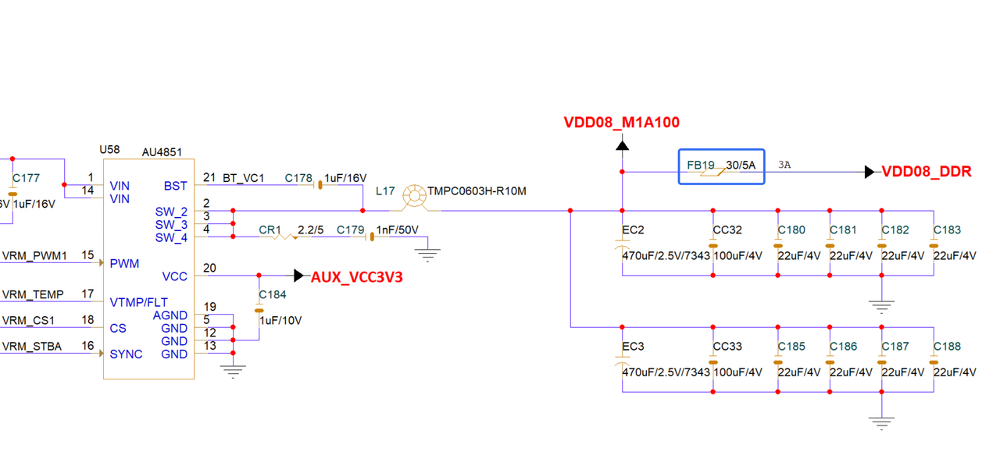
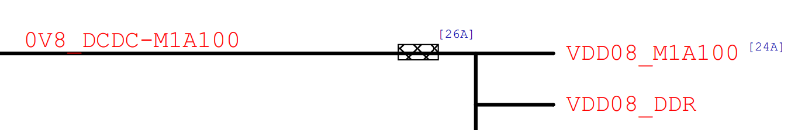

# K3 Hardware Design Buglist

## Revision History

| Version | Date | Description |
| --- | --- | --- |
| V1.0 | 2026.10.15 | Initial release; documents design issues identified in the [Reference Design Schematics](k3_hw_resources.md) and [Hardware Design Guide](k3_hw_design_guide.md). |

## 1. VDD0V8_DDR Design Requirements Buglist

### 1.1 Potential Design Issues

VDD0V8_DDR is supplied from VDD08_M1A100 through a ferrite bead. The reference schematic specifies a ferrite bead with a DCR of 30 mΩ and a rated current of 5 A.

The reference design is shown below.

With this design, the voltage drop across the ferrite bead and PCB copper causes the VDD0V8_DDR voltage at the load to be more than 50 mV below VDD08_M1A100 (the maximum VDD0V8_DDR current is approximately 2 A). This causes VDD0V8_DDR to fall below its minimum required voltage, which can result in LPDDR5 read/write errors and, in severe cases, OS crashes.

### 1.2 Design Improvements

#### 1.2.1 Short-Term Workaround for Existing Boards

If the board has already been fabricated according to the reference design and returned for testing, a short-term workaround is to short-circuit the ferrite bead with solder. This can mitigate LPDDR read/write errors, but the issue must ultimately be resolved through the long-term solution.

#### 1.2.2 Long-Term Design Solution

Connect VCC_SYS and VDD0V8_DDR directly to a common power plane without ferrite bead isolation, as shown in the topology below.

> **Design Requirements**
>
> VDD0V8_DDR ripple must be controlled to Vripple-pp ≤ 70 mV, with recommended Vripple-min ≥ -35 mV and Vripple-max ≤ 35 mV.
>
> **Noise Requirements:** Vnoise-pp ≤ 140 mV, with recommended Vnoise-min ≥ -70 mV and Vnoise-max ≤ 70 mV.
>
>
> This requirement must be considered together with the second Buglist item.

## 2. VCC_CPUX and VCC_SYS CPU Core Power Design Requirements Buglist

### 2.1 Potential Design Issues

Section 1.2.5 in the [Hardware Design Guide](k3_hw_design_guide.md) specified separate power supplies for X100 and A100. Under this design, the measured VCC_SYS ripple (the A100 power rail) is: Vripple-pp > 130 mV, Vripple-min < -80 mV, and Vripple-max > 50 mV.
> The chip (K3) has 16 high-performance cores: 8 X100 cores and 8 A100 cores. X100 and A100 are powered independently by two rails from a multi-phase controller.

Because VDD0V8_DDR shares the VCC_SYS power supply, this ripple does not meet the VDD0V8_DDR design requirements.

### 2.2 Design Improvements

The latest version of the [Hardware Design Guide](k3_hw_design_guide.md) requires X100 and A100 to share a common power supply. A common PCB power plane significantly improves the board-level PDN, while the terminal decoupling capacitors for X100 and A100 work together.

Verification results show that the design requirement of Vripple-pp ≤ 70 mV can be met.

> **Note**
>
> The final Vripple-pp value depends strongly on the PCB design, the dynamic response of the multi-phase power supply, and the supply capacitors. Internal verification results indicate that the design target can be achieved. Customer designs must carefully consider the effects of layout, power-supply selection, and supply capacitors; PI simulation is recommended.
