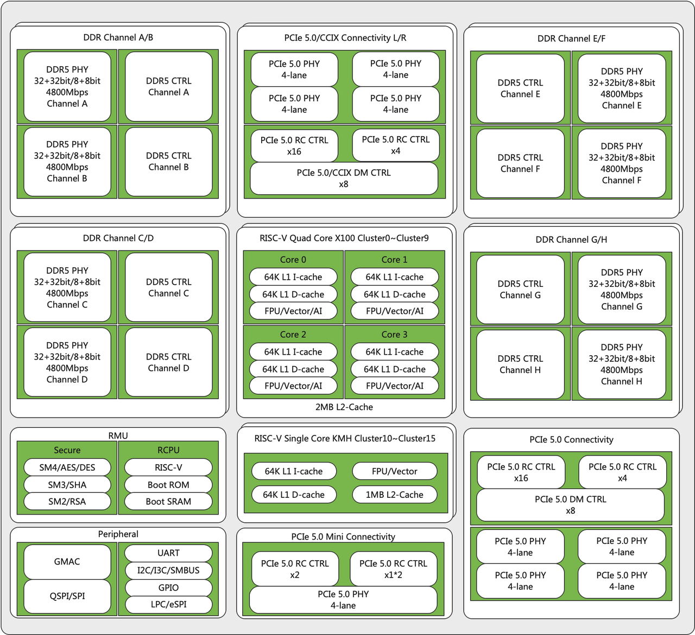

# V100 Brief

Click to download **[V100 Core Brief (PDF)](https://cdn-resource.spacemit.com/file/chip/V100/v100_brief_en.pdf)**

## Overview

**First RISC-V CPU that fully meets server specification requirements**

The SpacemiT Vital Stone V100 RISC-V server processor features high clock frequency, high core count, high reliability, strong scalability, and high security. It integrates 46 RISC-V CPU cores, is fully compatible with the RISC-V RVA23 Profile, and operates at up to 2.4 GHz, providing strong compute capability for data centers.

As a RISC-V CPU that fully meets server specification requirements, it is suitable for data center AI training servers, inference servers, general-purpose compute servers, storage servers, and edge servers.

- **Excellent Data Center CPU Performance**

  46 RISC-V high-performance cores, including 6 × XiangShan Kunminghu V2R2 CPU cores and 40 × SpacemiT X100 CPU cores.

  Kunminghu V2R2 operates at up to 2.1 GHz with SPECint2006 ≥ 15.0/GHz per core. X100 operates at up to 2.4 GHz with SPECint2006 ≥ 9.0/GHz per core. Supports RVA23 Profile.

- **RISC-V Server-Class Virtualization**

  Supports CPU virtualization, Hypervisor 1.0 extension, memory virtualization, interrupt virtualization, standard AIA interrupt controller, and IOMMU-based device virtualization.

- **RISC-V Data Center Security Architecture**

  Supports trusted computing, hardware Root of Trust (RoT), secure boot, key management, lifecycle management, secure debugging, and mainstream commercial cryptographic algorithms.

- **High-Bandwidth DDR5 Memory**

  Single chip supports 8 DDR5 channels with 1DPC. Compatible with mainstream DDR5 RDIMM. Up to 4800 MT/s and 307 GB/s peak bandwidth. Supports multi-level arbitration, QoS policies, bandwidth limiting, and performance monitoring.

- **RAS (Reliability, Availability, Serviceability)**

  Supports full RISC-V server RAS features covering CPU, memory, PCIe, and bus subsystems. Integrated multi-point temperature sensors with real-time BMC monitoring and dynamic adjustment. Supports efficient in-band and out-of-band management via firmware.

- **High-Performance PCIe 5.0 for AI Workloads**

  Supports PCIe 5.0 with up to 52 high-speed lanes. Supports multiple configurations from x16 to x1. Supports expansion of AI accelerator cards with 4/8-card deployment. Compatible with SAS/SATA and NVMe storage devices.

- **Full RISC-V Server Specification Compliance**

  Complies with RISC-V server-related specifications, including: RISC-V Server SoC Specification, RISC-V Server Platform Specification, RISC-V RVA23 Profile, Boot & Runtime Services (BRS), and RISC-V Security Model.

## Specifications

- **46-core high-performance RISC-V processor**
  - 6 × Kunminghu V2R2 + 40 × X100 cores, RVA23 supported
  - Kunminghu V2R2
    - 2.1 GHz
    - 13-stage, 6-issue out-of-order pipeline
    - 64 KB L1 I-Cache, 64 KB L1 D-Cache, 1 MB L2 Cache
  - X100
    - Up to 2.4 GHz
    - DVFS supported
    - 12-stage, 4-issue out-of-order pipeline
    - 64 KB L1 I-Cache, 64 KB L1 D-Cache, 2 MB L2 Cache
  - 64 MB SLC Cache

- **RISC-V Server-Class Virtualization**
  - CPU virtualization: Hypervisor 1.0, memory virtualization (SV48×4 / SV39×4 Guest address translation)
  - Interrupt virtualization: RISC-V AIA, supports 255 M-mode MSI, 255 S-mode MSI, 63 VS-mode MSI, up to 7 vCPUs per VS hart
  - Device virtualization: IOMMU-based I/O virtualization with SR-IOV for improved VM I/O performance

- **RISC-V Server Security Architecture**
  - RISC-V Standards: Supports RISC-V security components including PMP/ePMP and IOPMP (Rapid-k Model)
  - Server Security: Trusted computing, secure boot, key management, lifecycle management, and secure debugging
  - Security Hardware: Integrated HSM security module supporting key management and Root of Trust (RoT)-based secure boot
  - Cryptography support: AES / SHA / RSA / SM2 / SM3 / SM4

- **RISC-V Server RAS Features**
  - RISC-V Standards: RERI RAS specification support
  - CPU RAS: CE/UEC handling and interrupt logging
  - Memory RAS: ECC/CRC, patrol, fault isolation, address protection
  - PCIe RAS: link recovery, error reporting, hot plug, logging
  - Bus RAS: data validation/marking, SRAM ECC protection
  - System RAS: motherboard, network, GPU, and storage RAS management
  - RAS Management: Firmware-first design for efficient in-/out-of-band management

- **Memory**
  - Up to 8 DDR5 channels, 1DPC
  - Supports mainstream DDR5 RDIMM
  - Up to 4800 MT/s, 307 GB/s bandwidth
  - Supports 80-bit ECC DIMMs per channel with Sideband ECC
  - Up to 256 GB per DIMM, up to 2 TB per chip

- **High-Speed Interfaces**
  - Supports PCIe 5.0 with 52 high-speed lanes
  - Supports 3 groups of x16 / x8x8 / x8x4x4 configurations, and 1 group of x2x1x1
  - Supports SAS/SATA over PCIe, NVMe over PCIe, USB over PCIe, and more
  - 1 × GMAC with IEEE 1588 support

- **Peripheral I/O**
  - 1 × QSPI
  - 1 × LPC, 1 × eSPI
  - 3 × SPI Master, 1 × SPI Slave
  - 4 × I3C, 12 × I2C, 12 × SMBus
  - 5 × UART

- **RISC-V Server Software Stack**
  - Compliant with UEFI 2.11 and ACPI 6.6, with EDK2-based server BIOS support
  - Supports OpenBMC-based in-band and out-of-band management firmware
  - Supports mainstream compiler toolchains, including GCC and LLVM
  - Supports Linux kernel 6.6 and later
  - Supports mainstream server operating systems, including openEuler, openKylin, Kylin (planned), Ubuntu, Debian, and Fedora
  - Supports mainstream open-source middleware and databases, including Tomcat, Redis, Apache, MySQL, and PostgreSQL
  - Supports virtualization software, including KVM and QEMU
  - Supports Docker container deployment

- **Power**
  - TDP: 120W
  - Operating temperature: 0 ~ 40°C

- **Package**
  - FCBGA, 58.5 mm × 75.4 mm, 0.94 mm pitch

## Block Diagram

